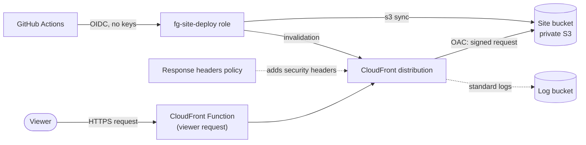

# labs/00-site-hosting

The site's own hosting, and the first lab a reader can deploy: a **private S3 bucket behind
CloudFront**, reached through an origin access control (OAC).



## What it creates

- the site bucket (private, versioned, encrypted, no ACLs, Block Public Access on) whose policy lets
  only this distribution read objects;
- a CloudFront distribution with a viewer-request CloudFront Function (directory index rewrite,
  trailing slash redirect, redirect from the `cloudfront.net` name to the custom domain), a response
  headers policy built from [`apps/site/headers.json`](../../apps/site/headers.json), HTTPS only, and
  the site's 404 page for missing files;
- CloudFront standard logs (v2) delivered to the lab's own log bucket, which expires them after 30
  days;
- optionally, a custom domain: an ACM certificate in `us-east-1`, its DNS validation records and the
  `A` and `AAAA` alias records in a Route 53 hosted zone you already have;
- the `fg-site-deploy` IAM role that the deploy workflow assumes through GitHub OIDC, from the
  `production` environment only. It can list and write the site bucket and invalidate this
  distribution, and nothing else.

Both buckets have `force_destroy = true`: the site is rebuilt from the repository and the logs are
disposable, so a destroy empties them.

## Inputs

Set them in `terraform.tfvars` for a local run (copy [`terraform.tfvars.example`](terraform.tfvars.example),
the file is git-ignored) or as repository Actions variables for CI.

| tfvars name         | Repository variable        | Default                           | Meaning                                                                                     |
| ------------------- | -------------------------- | --------------------------------- | ------------------------------------------------------------------------------------------- |
| `github_sub_prefix` | `TF_VAR_GITHUB_SUB_PREFIX` | none, required                    | OIDC subject prefix of your repository, for example `repo:your-user/saa-c03-field-guide`.   |
| `domain_name`       | `TF_VAR_DOMAIN_NAME`       | `null`: the `cloudfront.net` name | Custom domain, for example `site.example.com`. Lowercase, at least two labels, no wildcard. |
| `hosted_zone_id`    | `TF_VAR_HOSTED_ZONE_ID`    | `null`                            | Route 53 hosted zone that holds the domain. Set it if and only if `domain_name` is set.     |

`headers_json` also exists, for the tests only: leave it unset, the stack reads `apps/site/headers.json`.

Without a domain the site is served at the `https://<id>.cloudfront.net` name the `site_url` output
prints, with the default certificate (CloudFront then allows no newer minimum TLS version than
`TLSv1`). With a domain it uses an ACM certificate and `TLSv1.2_2021`.

## Quick start in your own account

Deploy the lab from your laptop, with local Terraform state and no custom domain. You need:

- Terraform 1.14 or newer (`.terraform-version` at the repository root pins the version CI uses);
- AWS CLI v2;
- Node and pnpm, at the versions in the root `package.json`;
- bash 4 or newer to run `verify.sh` (Git Bash on Windows works; the bash 3.2 that macOS ships is too
  old, so run `brew install bash`);
- an IAM Identity Center session for your AWS account: `aws sso login --profile <profile>`, then set
  `AWS_PROFILE` to that profile.

Run every command from `labs/00-site-hosting/` unless a step says otherwise.

1. Apply `bootstrap/workload` once, following [its README](../../bootstrap/workload/README.md), and
   leave the hosted zone out. It creates the GitHub OIDC provider and the `fg-workload-boundary`
   permissions boundary that this lab's deploy role needs (IAM refuses to create a role whose
   boundary policy does not exist), plus account-wide guardrails. Without a hosted zone it costs $0.
   Its prerequisite `bootstrap/management` is only for an AWS Organization: a standalone account
   skips it. The account-level S3 Block Public Access it turns on applies to **every** bucket in the
   account. An account can have only one GitHub OIDC provider: if yours already has one, import it
   as that README says.

2. Use a local backend. `backend_override.tf` is git-ignored:

   ```bash
   printf 'terraform {\n  backend "local" {}\n}\n' > backend_override.tf
   ```

   PowerShell (do not use `>` here: Windows PowerShell 5.1 would write UTF-16, which Terraform
   cannot read):

   ```powershell
   Set-Content backend_override.tf "terraform {`n  backend `"local`" {}`n}" -Encoding ascii
   ```

3. Create `terraform.tfvars` (git-ignored) with only your OIDC subject prefix, the same value you gave
   `bootstrap/workload`. Leave `domain_name` and `hosted_zone_id` out: the site is then served at
   the `cloudfront.net` name.

   ```hcl
   github_sub_prefix = "repo:your-user/saa-c03-field-guide"
   ```

4. Initialise, plan, read the plan, then apply the saved plan. Write `-out lab.tfplan` with a space:
   PowerShell splits an `=` after `-out` at the dot of the file name. The `.tfplan` name is
   git-ignored. CloudFront takes a few minutes to deploy.

   ```bash
   terraform init
   terraform plan -out lab.tfplan
   terraform apply lab.tfplan
   ```

5. Build the site and upload it the way `deploy.yml` does (the smoke test checks these cache
   headers). From the repository root:

   ```bash
   pnpm install --frozen-lockfile
   pnpm build
   ```

   Then, from the lab directory:

   ```bash
   aws s3 sync ../../apps/site/dist/_astro "s3://$(terraform output -raw site_bucket_name)/_astro" --cache-control "public, max-age=31536000, immutable"
   aws s3 sync ../../apps/site/dist "s3://$(terraform output -raw site_bucket_name)" --exclude "_astro/*" --delete --cache-control "max-age=0, s-maxage=86400, must-revalidate"
   aws cloudfront create-invalidation --distribution-id "$(terraform output -raw distribution_id)" --paths "/*"
   ```

   These lines work in PowerShell and in bash. In Git Bash on Windows, Git Bash would rewrite `/*`
   into a Windows path: start the last line with `MSYS_NO_PATHCONV=1 `, or run the three lines in
   PowerShell.

6. Check the stack with `bash verify.sh` (see [Verify](#verify)). Expect
   `verify: ok (16 passed, 1 skipped)`: `redirect-to-domain` is skipped without a custom domain.
   Then, from the repository root, check the live site with `pnpm smoke --url <site_url output>`.

7. Break it on purpose: see [`break-it.md`](break-it.md).

8. Clean up. Run `terraform destroy` (`force_destroy` empties the buckets), then delete
   `backend_override.tf`, `terraform.tfstate*`, `lab.tfplan` and `terraform.tfvars`. Destroy
   `bootstrap/workload` too, following its README, only if nothing else in the account uses it.

## How CI applies it

`infra.yml` is the only way this lab changes. A pull request gets a read-only plan as a comment
and a cost estimate. After the merge, the plan is repeated, you approve it in the `infra`
environment, and only the approved change set is applied. You can also dispatch `plan`, `apply`
or `destroy` for the lab on demand.

The `Export lab variables` step of `infra.yml` turns every repository variable named `TF_VAR_<NAME>`
into the Terraform input `<name>`, so no value is committed. Set `TF_VAR_*` on the repository, not on
an environment: the apply job also sees the variables of the `infra` environment, a different value
there changes the plan, and the digest check then refuses to apply. Never put secrets in `TF_VAR_*`
variables: the domain, the zone ID and the subject prefix are printed in the run log, and they are
not secret.

The same `TF_VAR_*` variables reach every lab, not only this one. A future lab must not declare
`domain_name`, `hosted_zone_id` or `github_sub_prefix` unless it means the same value.

A change to `apps/site/headers.json` plans and applies this lab, because the headers policy is built
from that file. The plan fails, with a message that names the file, when one of the five security
headers is missing or has a value CloudFront would reject.

To run it from your own machine with an IAM Identity Center session for the workload account:

```bash
terraform init -backend-config="bucket=field-guide-tfstate-<ACCOUNT_ID>" \
  -backend-config="key=labs/00-site-hosting.tfstate"
terraform plan -out=tfplan
```

## Deploying the site

`deploy.yml` builds the site and uploads it to this lab's bucket. It runs on every push to `main`
that changes the site or what it is built from, and you can dispatch it by hand. It never runs for
pull requests.

1. The `build` job builds the site once and stores it as an artifact named after the commit. It has
   no AWS access.
2. The `deploy` job waits for your approval in the `production` environment, assumes the
   `fg-site-deploy` role through GitHub OIDC (no AWS keys), uploads the site, invalidates the
   CloudFront cache and checks that the bucket is not readable directly.
3. The `smoke` job then checks the live site (`pnpm smoke --url <site URL>`): the pages, the
   redirects, the 404 page, the security headers of `apps/site/headers.json`, the cache headers, the
   content types and TLS.

Set this up in your repository before the first deploy:

- Create the **`production`** environment with yourself as required reviewer, `main` as the only
  deployment branch and no administrator bypass. Leave _Prevent self-review_ off: you approve your
  own runs. Do it first: a workflow that names a missing environment creates an unprotected one.
- On the `production` environment, add the secret `SITE_DEPLOY_ROLE_ARN` (the `deploy_role_arn`
  output of this stack) and the variable `SITE_DISTRIBUTION_ID` (the `distribution_id` output).
- On the repository, add the variables `SITE_URL` (the `site_url` output, for example
  `https://site.example.com`) and `SITE_CLOUDFRONT_DOMAIN` (the `distribution_domain_name` output).
  Leave `SITE_CLOUDFRONT_DOMAIN` unset if you use no custom domain: the smoke test then skips the
  checks that need one.

Runs are queued one at a time, and a newer queued run replaces an older queued one.

### Rolling back

A bad deploy is undone without a code change, in one of two ways:

- **Re-run the `deploy` job** of the last good run in the Actions tab. It uploads that run's artifact
  again, with no new build. This works for 30 days after that run, as long as its artifact is kept.
- **Dispatch `deploy.yml` from `main`** with `ref` set to the full SHA (40 characters) of a good
  commit on `main`: a merge commit or a direct commit, of any age. It rebuilds that commit and
  deploys it. A queued dispatch is replaced if a push run is queued after it.

Both ways wait for your approval and end with the smoke test.
If the job fails while waiting for the CloudFront invalidation (it waits up to 10 minutes), the new
site is already uploaded and the invalidation is only slow: re-run the `deploy` job to finish it.

### Changing the headers

A push that changes `apps/site/headers.json` starts both `infra.yml`, which applies the new headers,
and `deploy.yml`. Approve the `infra` apply first. If the `smoke` job ran before the apply finished,
it fails on the old headers: re-run that job alone ("Re-run failed jobs") once the apply is done.

## Verify

`verify.sh` checks an applied stack, yours or this site's, with read-only calls. Run it from the stack
directory, after `terraform init` or a local apply: `bash verify.sh`. It reads everything from the
`terraform output` values of the stack. It checks:

- **site bucket:** Block Public Access is on, the bucket is not public, its policy names this
  distribution and the `cloudfront.amazonaws.com` principal (OAC), versioning is enabled and
  encryption is AES256;
- **log bucket:** Block Public Access is on;
- **distribution:** it is deployed and enabled, viewers are redirected to HTTPS, the origin uses an
  origin access control and the site bucket's regional S3 endpoint, the viewer-request function is
  attached, and TLS is `TLSv1.2_2021` with SNI (with a custom domain) or the default certificate;
- **deploy role:** `fg-site-deploy` has the path `/lab/` and the `fg-workload-boundary` boundary;
- **live probes:** the bucket cannot be read directly, HTTP redirects to HTTPS, and the redirects of
  the function stay on the site (protocol-relative and backslash paths) and keep query values encoded.
  With a custom domain it also checks the redirect from the `cloudfront.net` name to the domain.

A change to only the function or the headers policy can leave the distribution `InProgress` for
minutes after Terraform returns, so the script waits for it, up to 10 minutes, before it checks.

It only reads, and it prints no account ID or bucket name, so the output is safe in a public log.
`infra.yml` runs it after each apply of this lab, with the read-only `fg-tf-plan` role.

Exit codes: `0` every check passed, `1` a check failed, `2` the script could not run (a missing tool,
an argument, or an empty `terraform output`).

The query probe exists because CloudFront hands query values to the function still encoded, and the
function copies them as they are: `%26` stays `%26`, so `?a=b%26c` is one value, not two.

## Cost

Estimated with `infracost breakdown --path .`: **$0.00 per month** of fixed cost. Nothing here costs
money while idle: there is no NAT gateway, load balancer, Elastic IP or database. CloudFront, the
function and the buckets only bill for use: the always-free allowance of CloudFront (1 TB and 10
million requests a month) and of CloudFront Functions (2 million invocations) covers a study site,
and S3 storage for a few megabytes is a fraction of a cent. The log delivery to S3 is billed by
CloudWatch per GB of logs, which is cents at this traffic. A hosted zone costs $0.50 a month, but it
belongs to the bootstrap stack, not to this lab.

The [quick start](#quick-start-in-your-own-account) costs the same: $0.00 fixed, usage only.
`bootstrap/workload` applied without a hosted zone adds $0.

## Destroy

Dispatch `infra.yml` from `main` with the action `destroy`, the stack `labs/00-site-hosting`, and
the confirmation `destroy labs/00-site-hosting`; you approve it in the `infra` environment.
The buckets are emptied by `force_destroy`. The custom domain's records and certificate go with the
stack. For a local run, `terraform destroy` does the same.

A [quick start](#quick-start-in-your-own-account) stack is destroyed with `terraform destroy` from
the lab directory.
