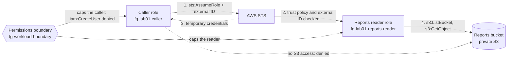

# Lab 01: IAM role assumption and a permissions boundary

## What you build

Task 1.1 of the exam guide, secure access to AWS resources, in one account and for $0. Read the
[guide page for task 1.1](../../apps/site/src/content/docs/d1/1-1-secure-access/) first. This lab
builds the setup of its `iam-cross-account-assume-role` diagram, plus a permissions boundary.

- **A caller role** (`fg-lab01-caller`). It may assume the reports reader, and nothing else. It also
  has an allow for `iam:CreateUser`, which the permissions boundary cancels.
- **A reports reader role** (`fg-lab01-reports-reader`). Its trust policy names the **account root**
  and requires an **external ID**. It can list and read one private bucket.
- **A reports bucket**, private, encrypted, with no ACLs and Block Public Access on. Only the reports
  reader can read it. Terraform puts no object in it: you upload `report.txt` yourself (see
  [Observe](#observe)). The CI role that plans this stack may not read objects, so a managed object
  would break the plan.

Both roles carry `fg-workload-boundary`, the permissions boundary from `bootstrap/workload`, and live
under the path `/lab/`. The boundary always denies creating IAM users, access keys and console
passwords, so the caller's `iam:CreateUser` allow can never work.

The diagram's accounts A and B are the **same account** here, built as if they were two. The trust
policy names the account root, so the choice of who may assume the role moves to the identity
policies of the account. Across two accounts, the caller needs an allow on its own side and the
target needs an allow on its side. Here the caller's policy is one side and the trust policy is the
other, and you can break each side on its own ([`break-it.md`](break-it.md)).



## Cost

Estimated with `infracost breakdown --path .`: **$0.00 per month**. IAM roles and policies are free.
The one thing that bills is S3, by use: storage and requests for one small text file are well under
a cent. Nothing runs by the hour: there is no NAT gateway, load balancer, Elastic IP or database, so
there is nothing to forget. `bootstrap/workload` adds $0 when applied without a hosted zone.

## Prerequisites

- Terraform 1.14 or newer.
- AWS CLI v2.
- An IAM Identity Center session with admin rights in your AWS account:
  `aws sso login --profile <profile>`, then set `AWS_PROFILE` to that profile.
- `bootstrap/workload` applied, following [its README](../../bootstrap/workload/README.md). It creates
  `fg-workload-boundary`, and IAM refuses to create a role whose boundary policy does not exist.
- bash 4 or newer to run `verify.sh` and the commands below. On Windows use Git Bash; typing `bash`
  in PowerShell may start WSL, which has none of your tools or your SSO session. On macOS the bash
  3.2 that ships with the system is too old, so run `brew install bash`.

## Inputs

Both are optional. For a local run, copy [`terraform.tfvars.example`](terraform.tfvars.example) to
`terraform.tfvars` (git-ignored) and edit it.

| Name                 | Default                | Meaning                                                                                                                                                             |
| -------------------- | ---------------------- | ------------------------------------------------------------------------------------------------------------------------------------------------------------------- |
| `external_id`        | `"field-guide-lab-01"` | The external ID the reports reader requires. 2 to 1224 characters from `A-Z a-z 0-9 _ + = , . @ : / -`. **Not a secret**: it is plain text in the plan and the log. |
| `trusted_account_id` | `null`                 | A second account (12 digits) whose root the reports reader also trusts. Local runs only: see [the optional second account](#optional-a-real-second-account).        |

Do not set `trusted_account_id` as a repository variable (`TF_VAR_TRUSTED_ACCOUNT_ID`): `infra.yml`
would print that account ID in the plan log, and the logs of this repository are public.

## Quick start in your own account

Run every command from `labs/01-iam-assume-role/`.

1. Use a local backend. `backend_override.tf` is git-ignored:

   ```bash
   printf 'terraform {\n  backend "local" {}\n}\n' > backend_override.tf
   ```

   PowerShell (do not use `>` here: Windows PowerShell 5.1 would write UTF-16, which Terraform
   cannot read):

   ```powershell
   Set-Content backend_override.tf "terraform {`n  backend `"local`" {}`n}" -Encoding ascii
   ```

2. Initialise, plan, read the plan, then apply the saved plan. Write `-out lab.tfplan` with a space:
   PowerShell splits an `=` after `-out` at the dot of the file name. The `.tfplan` name is
   git-ignored.

   ```bash
   terraform init
   terraform plan -out lab.tfplan
   terraform apply lab.tfplan
   ```

   The plan has nine resources: two roles, two inline policies and the bucket with its four
   settings.

3. Check it with `bash verify.sh` (see [Verify](#verify)).

4. Try it by hand ([Observe](#observe)), then break it on purpose ([`break-it.md`](break-it.md)).

CI applies this lab too: `infra.yml` plans it on a pull request, applies it after merge once you
approve it in the `infra` environment, and then runs `verify.sh` with the read-only `fg-tf-plan`
role.

## Observe

You are the admin and the lab roles are two identities you can step into. Use one terminal for all of
these steps, so the shell variables stay.

1. Read the outputs and upload a report as the admin. You use the admin session because the caller
   cannot write to the bucket.

   ```bash
   BUCKET=$(terraform output -raw reports_bucket_name)
   CALLER_ARN=$(terraform output -raw caller_role_arn)
   TARGET_ARN=$(terraform output -raw target_role_arn)
   EXTERNAL_ID=$(terraform output -raw external_id)
   echo "Q3 numbers" > report.txt
   aws s3 cp report.txt "s3://$BUCKET/report.txt"
   ```

2. Assume the caller. The trust policy names the account root and has no condition, so any principal
   of the account whose own policy allows `sts:AssumeRole` can do it. The keys stay in shell
   variables. `as_caller` runs one command with them and without your profile:

   ```bash
   read -r CK CS CT < <(aws sts assume-role --role-arn "$CALLER_ARN" --role-session-name lab01-caller \
     --query 'Credentials.[AccessKeyId,SecretAccessKey,SessionToken]' --output text | tr -d '\r')
   as_caller() { env -u AWS_PROFILE -u AWS_DEFAULT_PROFILE AWS_ACCESS_KEY_ID="$CK" \
     AWS_SECRET_ACCESS_KEY="$CS" AWS_SESSION_TOKEN="$CT" "$@"; }
   as_caller aws sts get-caller-identity
   ```

   The `Arn` ends in `assumed-role/fg-lab01-caller/lab01-caller`.

3. Try to list and read the reports as the caller. Both are refused, because the caller's policy has
   no S3 action. The list fails with `AccessDenied`. The copy fails with `403` (`Forbidden`): its
   first call is a `HEAD` request, and a `HEAD` response has no error body, so the CLI can only show
   the status.

   ```bash
   as_caller aws s3 ls "s3://$BUCKET"
   as_caller aws s3 cp "s3://$BUCKET/report.txt" -
   ```

4. Assume the reports reader as the caller, with the external ID. It works. A role assumed by
   another role is **role chaining**, and it caps the session at 1 hour, whatever the role's own
   maximum is. The roles of this lab have a 1 hour maximum too, so you cannot tell the two limits
   apart here. Asking for more fails with a `ValidationError`:

   ```bash
   as_caller aws sts assume-role --role-arn "$TARGET_ARN" --role-session-name lab01-reader \
     --external-id "$EXTERNAL_ID" --duration-seconds 7200
   read -r RK RS RT < <(as_caller aws sts assume-role --role-arn "$TARGET_ARN" \
     --role-session-name lab01-reader --external-id "$EXTERNAL_ID" \
     --query 'Credentials.[AccessKeyId,SecretAccessKey,SessionToken]' --output text | tr -d '\r')
   as_reader() { env -u AWS_PROFILE -u AWS_DEFAULT_PROFILE AWS_ACCESS_KEY_ID="$RK" \
     AWS_SECRET_ACCESS_KEY="$RS" AWS_SESSION_TOKEN="$RT" "$@"; }
   ```

5. Assume it again without the external ID, and with a wrong one. Both are `AccessDenied`, even
   though the caller's own policy allows the call. The trust policy is the other side, and it says no:

   ```bash
   as_caller aws sts assume-role --role-arn "$TARGET_ARN" --role-session-name lab01-reader
   as_caller aws sts assume-role --role-arn "$TARGET_ARN" --role-session-name lab01-reader \
     --external-id not-the-right-one
   ```

6. List and read the report as the reports reader. Both work:

   ```bash
   as_reader aws s3 ls "s3://$BUCKET"
   as_reader aws s3 cp "s3://$BUCKET/report.txt" -
   ```

7. Ask the caller to create an IAM user. The caller's policy allows it, but the answer is
   `AccessDenied` "with an explicit deny in a permissions boundary":

   ```bash
   as_caller aws iam create-user --user-name lab01-demo
   ```

   The effective permission is what the identity policy **and** the boundary both allow, and an
   explicit deny in either wins. A boundary caps; it never grants. If the user is ever created
   (the boundary is broken), delete it with your admin session:
   `aws iam delete-user --user-name lab01-demo`.

The caller's session lasts 1 hour. If a command says the token has expired, run step 2 and step 4
again. Delete `report.txt` from the lab directory when you are done.

## Optional: a real second account

Everything above uses one account. To see it across two, you need a second account that you own.

1. In `terraform.tfvars`, set `trusted_account_id = "444455556666"` with the real ID of your second
   account, and apply. The reports reader now trusts both account roots, with the same external ID.
   Plan and apply from your laptop: the CI plan log is public, so CI leaves this unset.
2. In the second account, a principal with its own `sts:AssumeRole` allow on the reports reader's ARN
   (the `target_role_arn` output) calls
   `aws sts assume-role --role-arn <target_role_arn> --role-session-name lab01-b --external-id field-guide-lab-01`.
   It works: both sides allow. Leave out the external ID, and it fails.
3. Wait up to 30 minutes. The account analyzer of `bootstrap/workload` (IAM Access Analyzer) reports
   the reports reader as shared with the other account. `bash verify.sh` checks it
   (`external-access-finding`) and prints `skip` until the finding exists.
4. Remove the line from `terraform.tfvars` and apply again to undo it.

A denied cross-account `AssumeRole` is logged in CloudTrail in the **caller's** account, so look
there to find out why it failed.

## Verify

`bash verify.sh` checks an applied stack, yours or the one CI applied. Run it from the stack
directory, after `terraform init` or a local apply, in Git Bash on Windows. It reads everything from
the `terraform output` values. It prints `ok`, `FAIL` or `skip` per check, and no account ID, ARN
or bucket name, so the output is safe in a public log. It checks:

- **both roles:** path `/lab/` and the `fg-workload-boundary` permissions boundary;
- **trust policies:** the caller trusts the account root with no condition; the reports reader trusts
  the account root (and `trusted_account_id` when set) and requires the external ID;
- **the bucket:** Block Public Access is on;
- **the IAM policy simulator:** the caller may assume the reports reader; `iam:CreateUser` is an
  explicit deny, and an allow when the boundary is swapped for "allow everything", so the deny is the
  boundary's doing; the caller cannot list the bucket and the reports reader can list and read it;
- **Access Analyzer:** the finding for the second account, only when `trusted_account_id` is set.

The simulator does not read trust policies, so the external ID can only be tested for real. With
`VERIFY_ASSUME=1 bash verify.sh` the script also assumes the caller with your identity, then the
reports reader with and without the external ID, and lists the bucket as each. It needs
`sts:AssumeRole`, which the read-only CI role does not have, so CI runs without it. The keys stay in
the environment of each command and are never printed. It never calls `iam:CreateUser`.

Expect `verify: ok (12 passed, 7 skipped)`, or `verify: ok (18 passed, 1 skipped)` with
`VERIFY_ASSUME=1` (the finding check is skipped without `trusted_account_id`).

Exit codes: `0` every check passed, `1` a check failed, `2` the script could not run (an argument, a
missing tool, an empty `terraform output` or no AWS session).

## Destroy now

Nothing here costs money while idle, but clean up when you finish.

- **Local stack:** `terraform destroy` from the lab directory. `force_destroy` empties the bucket, so
  your `report.txt` does not block it. Then delete `backend_override.tf`, `terraform.tfstate*`,
  `lab.tfplan`, `terraform.tfvars` and `report.txt`. If you created `lab01-demo`, delete that user
  too. Destroy `bootstrap/workload` only if nothing else in the account uses it.
- **CI stack:** dispatch `infra.yml` from `main` with the action `destroy`, the stack
  `labs/01-iam-assume-role` and the confirmation `destroy labs/01-iam-assume-role`. You approve it in
  the `infra` environment.
