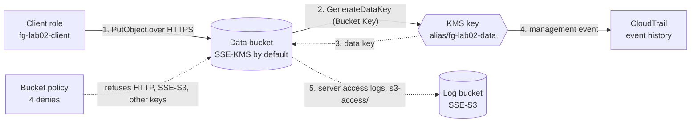

# Lab 02: S3 encryption with a KMS key, enforced by a bucket policy

## What you build

Task 1.3 of the exam guide, data security, for $1.00 a month. Read the
[guide page for task 1.3](../../apps/site/src/content/docs/d1/1-3-data-security/) first. This lab
builds the setup of its `s3-sse-kms-upload` diagram: an S3 bucket encrypted with a KMS key, a client
that needs the key permission, and the CloudTrail trail of the key use.

- **A customer managed KMS key** (alias `alias/fg-lab02-data`). It rotates every year. Its key policy
  is the default one: the account root may do everything, so IAM policies decide who may use the key.
- **A data bucket**, private, with no ACLs and Block Public Access on. It is encrypted by default
  with the lab key and an **S3 Bucket Key**, and SSE-C (a key the caller supplies) is blocked.
- **A bucket policy** with four denies and no allow (in one account the client's identity policy is
  enough to allow):
  - `DenyInsecureTransport`: every request over plain HTTP is refused.
  - `DenyOtherEncryption`: an upload whose `x-amz-server-side-encryption` header asks for anything
    but `aws:kms` is refused. That covers SSE-S3 (`AES256`) and DSSE-KMS (`aws:kms:dsse`).
  - `DenyOtherKmsKey`: an upload whose key-ID header is not the lab key's ARN is refused.
  - `DenyKmsWithoutKeyId`: `aws:kms` with no key-ID header is refused, because S3 would then use the
    AWS managed key `aws/s3` instead of the lab key.

  An upload that sends **no** encryption header is allowed. It gets the bucket default: the lab key
  and the Bucket Key.

- **A log bucket**, private and encrypted with SSE-S3. A server access log target cannot use a KMS
  key. It receives the **server access logs** of the data bucket under `s3-access/` through a bucket
  policy for the S3 logging service, and it expires them after 7 days.
- **A client role** (`fg-lab02-client`). Its identity policy allows the data bucket (list, read,
  write) and the key (`kms:GenerateDataKey` to upload, `kms:Decrypt` to download), the key only when
  S3 makes the call for it (`kms:ViaService`). Removing the key statement shows the diagram's
  "Missing KMS permission" scenario ([`break-it.md`](break-it.md)).

The role carries `fg-workload-boundary`, the permissions boundary from `bootstrap/workload`, and
lives under the path `/lab/`. Neither that boundary nor the organization's service control policy
names a `kms:` action or an S3 action on these buckets, so every deny in this lab comes from the
bucket policy, the client's policy or KMS.

Terraform puts no object in the bucket: the CI role that plans this stack may not read objects, so a
managed object would break the plan. You upload objects yourself (see [Observe](#observe)).



## Cost

Estimated with `infracost breakdown --path .`: **$1.00 per month**, for the KMS key. A customer
managed key costs $1.00 a month, prorated hourly: about 3 cents a day, so a lab that runs for an
afternoon costs a few cents. Everything else is usage: S3 storage and requests for a few small
objects are well under a cent, and KMS requests are 20,000 a month free (the Bucket Key keeps the
count low). The first yearly rotation would add $1.00 a month, but a lab never lives that long. A key
**pending deletion** after `terraform destroy` is free. Nothing else runs by the hour: there is no
NAT gateway, load balancer, Elastic IP or database.

## Prerequisites

- Terraform 1.14 or newer.
- A recent AWS CLI v2. An older v2 does not show `BlockedEncryptionTypes`, and `verify.sh` fails on
  it with a message that says so.
- An IAM Identity Center session with admin rights in your AWS account:
  `aws sso login --profile <profile>`, then set `AWS_PROFILE` to that profile.
- `bootstrap/workload` applied, following [its README](../../bootstrap/workload/README.md). It creates
  `fg-workload-boundary`, and IAM refuses to create a role whose boundary policy does not exist.
- bash 4 or newer to run `verify.sh` and the commands below. On Windows use Git Bash; typing `bash`
  in PowerShell may start WSL, which has none of your tools or your SSO session. On macOS the bash
  3.2 that ships with the system is too old, so run `brew install bash`.

The lab has no input variables. Example account IDs in this lab are AWS's documentation placeholder,
`111122223333`.

## Quick start in your own account

Run every command from `labs/02-s3-kms-encryption/`.

1. Use a local backend. `backend_override.tf` is git-ignored:

   ```bash
   printf 'terraform {\n  backend "local" {}\n}\n' > backend_override.tf
   ```

   PowerShell (do not use `>` here: Windows PowerShell 5.1 would write UTF-16, which Terraform
   cannot read):

   ```powershell
   Set-Content backend_override.tf "terraform {`n  backend `"local`" {}`n}" -Encoding ascii
   ```

2. Initialise, plan, read the plan, then apply the saved plan. Write `-out lab.tfplan` with a space:
   PowerShell splits an `=` after `-out` at the dot of the file name. The `.tfplan` name is
   git-ignored.

   ```bash
   terraform init
   terraform plan -out lab.tfplan
   terraform apply lab.tfplan
   ```

   The plan has sixteen resources: the key and its alias, the two buckets with their settings and
   policies, and the client role with its policy.

3. Check it with `bash verify.sh` (see [Verify](#verify)).

4. Try it by hand ([Observe](#observe)), then break it on purpose ([`break-it.md`](break-it.md)).

CI applies this lab too: `infra.yml` plans it on a pull request, applies it after merge once you
approve it in the `infra` environment, and then runs `verify.sh` with the read-only `fg-tf-plan`
role.

## Observe

Use one terminal for all of these steps, so the shell variables stay. The lab lives in `eu-west-1`.

1. Read the outputs and set the Region:

   ```bash
   export AWS_REGION=eu-west-1
   DATA=$(terraform output -raw data_bucket_name)
   LOGS=$(terraform output -raw log_bucket_name)
   KEY_ARN=$(terraform output -raw kms_key_arn)
   CLIENT_ARN=$(terraform output -raw client_role_arn)
   echo "lab 02 probe" > probe.txt
   ```

2. Assume the client. The trust policy names the account root and has no condition, so any principal
   of the account whose own policy allows `sts:AssumeRole` can do it. The keys stay in shell
   variables. `as_client` runs one command with them and without your profile:

   ```bash
   read -r CK CS CT < <(aws sts assume-role --role-arn "$CLIENT_ARN" --role-session-name lab02-client \
     --query 'Credentials.[AccessKeyId,SecretAccessKey,SessionToken]' --output text | tr -d '\r')
   as_client() { env -u AWS_PROFILE -u AWS_DEFAULT_PROFILE AWS_ACCESS_KEY_ID="$CK" \
     AWS_SECRET_ACCESS_KEY="$CS" AWS_SESSION_TOKEN="$CT" "$@"; }
   as_client aws sts get-caller-identity
   ```

   The `Arn` ends in `assumed-role/fg-lab02-client/lab02-client`. The session lasts 1 hour: run this
   step again if a command says the token has expired.

3. Upload with **no encryption header**. The bucket policy allows it, and default encryption does the
   rest. `head-object` shows `aws:kms`, the lab key and the Bucket Key:

   ```bash
   as_client aws s3 cp probe.txt "s3://$DATA/probe.txt"
   as_client aws s3api head-object --bucket "$DATA" --key probe.txt \
     --query '[ServerSideEncryption,SSEKMSKeyId,BucketKeyEnabled]' --output text
   ```

4. Upload asking for SSE-S3 (`AES256`). The bucket policy refuses it: `AccessDenied` "with an
   explicit deny in a resource-based policy". Without a value, `--sse` means `AES256` too:

   ```bash
   as_client aws s3 cp probe.txt "s3://$DATA/sse-s3.txt" --sse AES256
   ```

5. Upload asking for `aws:kms` **without a key ID**. This is `AccessDenied` too. S3 would encrypt
   with the AWS managed key `aws/s3`, not with the lab key, and `DenyKmsWithoutKeyId` refuses that:

   ```bash
   as_client aws s3 cp probe.txt "s3://$DATA/no-key.txt" --sse aws:kms
   ```

6. Upload naming the key in another form: the alias, or the bare key ID. Both are `AccessDenied`.
   The condition compares the header **as it is sent**, and only the key ARN matches. Then upload
   with the ARN (the `kms_key_arn` output). It works:

   ```bash
   as_client aws s3 cp probe.txt "s3://$DATA/alias.txt" --sse aws:kms --sse-kms-key-id alias/fg-lab02-data
   as_client aws s3 cp probe.txt "s3://$DATA/key-id.txt" --sse aws:kms --sse-kms-key-id "${KEY_ARN##*/}"
   as_client aws s3 cp probe.txt "s3://$DATA/key-arn.txt" --sse aws:kms --sse-kms-key-id "$KEY_ARN"
   ```

7. A client can still turn the Bucket Key off for one request. No condition key exists for it, so the
   bucket policy cannot refuse it. `head-object` then shows no `BucketKeyEnabled`:

   ```bash
   as_client aws s3api put-object --bucket "$DATA" --key no-bucket-key.txt --body probe.txt \
     --server-side-encryption aws:kms --ssekms-key-id "$KEY_ARN" --no-bucket-key-enabled
   as_client aws s3api head-object --bucket "$DATA" --key no-bucket-key.txt \
     --query '[ServerSideEncryption,SSEKMSKeyId,BucketKeyEnabled]' --output text
   ```

8. Download, over TLS, without encryption headers (a GET must not send them). S3 asks KMS to decrypt
   the data key, so the client needs `kms:Decrypt`. Then try plain HTTP: the bucket policy refuses
   it with `AccessDenied`:

   ```bash
   as_client aws s3 cp "s3://$DATA/probe.txt" -
   as_client aws s3api get-object --bucket "$DATA" --key probe.txt \
     --endpoint-url http://s3.eu-west-1.amazonaws.com /dev/null
   ```

9. The classic exam pattern, and why this lab does not use it. Many exam answers deny `PutObject`
   when the `x-amz-server-side-encryption` header is **missing** (a `Null` condition), to force every
   upload to be encrypted. Since January 2023 S3 encrypts every new object anyway, and this bucket's
   default is SSE-KMS, so an upload with no header is already encrypted with the lab key. The
   "missing header" deny would add nothing except refusing plain `aws s3 cp` calls. What a bucket
   policy can still add is the refusal of a **different** choice: the three other denies. The
   `IfExists` operators make them apply only when the header is sent, which also keeps multipart
   uploads working: only `CreateMultipartUpload` carries the headers, and `UploadPart` is authorized
   as `s3:PutObject` without them.

10. Find the key use in CloudTrail. `GenerateDataKey` and `Decrypt` are management events, so they
    show in the Event history a few minutes after the request (S3 object calls are data events and
    do not). With the Bucket Key on, the encryption context is the bucket ARN, not the object ARN, and
    S3 asks KMS far less than once per object:

    ```bash
    aws cloudtrail lookup-events --lookup-attributes AttributeKey=EventName,AttributeValue=GenerateDataKey \
      --max-results 20 --query 'Events[].CloudTrailEvent' --output text | tr -d '\r' | grep -o '"aws:s3:arn":"[^"]*"'
    ```

11. Read the server access logs. Delivery is best effort and can take **a few hours**. When logs
    arrive they are under `s3-access/` in the log bucket. Use your admin session:

    ```bash
    aws s3 ls "s3://$LOGS/s3-access/"
    ```

Delete `probe.txt` from the lab directory when you are done.

## Verify

`bash verify.sh` checks an applied stack, yours or the one CI applied. Run it from the stack
directory, after `terraform init` or a local apply, in Git Bash on Windows. It reads everything from
the `terraform output` values. It prints `ok`, `FAIL` or `skip` per check, and no account ID, ARN,
bucket name or key ID, so the output is safe in a public log. It checks, read-only:

- **the client role:** path `/lab/`, the `fg-workload-boundary` permissions boundary, and a trust
  policy for the account root with no condition;
- **the key:** enabled, customer managed, symmetric, single-Region, rotating, with the alias;
- **the data bucket:** default encryption with the lab key and the Bucket Key, SSE-C blocked, Block
  Public Access, the four denies and the TLS condition in the bucket policy, and server access logging;
- **the log bucket:** Block Public Access, SSE-S3, a policy that lets S3 deliver the logs for the data
  bucket, and logs that expire after 7 days;
- **the IAM policy simulator:** the client may upload, may use the key when S3 calls KMS for it, and
  may not use the key in any other way.

The simulator cannot read a bucket policy for a role, so the denies of the bucket policy can only be
tested for real. With `VERIFY_ASSUME=1 bash verify.sh` the script also assumes the client with your
identity, uploads a small probe object (`verify-probe.txt`) with and without the lab key, checks that
SSE-S3, `aws:kms` without a key ID, another key and plain HTTP are each refused **by the bucket
policy**, and downloads the object. It needs `sts:AssumeRole`, which the read-only CI role does not
have, so CI runs without it. The keys stay in the environment of each command and are never printed.
It never deletes an object: the probe stays until the next run overwrites it or `terraform destroy`
empties the bucket.

Expect `verify: ok (17 passed, 8 skipped)`, or `verify: ok (25 passed, 0 skipped)` with
`VERIFY_ASSUME=1`.

Exit codes: `0` every check passed, `1` a check failed, `2` the script could not run (an argument, a
missing tool, an empty `terraform output` or no AWS session).

## Destroy now

The key costs $1.00 a month while it exists, so clean up when you finish.

- **Local stack:** `terraform destroy` from the lab directory. `force_destroy` empties both buckets,
  so your probe objects and any late logs do not block it. If a log lands after the bucket was
  emptied and the destroy stops with a non-empty bucket, run it again. The key is not deleted at
  once: it goes **pending deletion** for 7 days and costs nothing in that time. The alias is removed
  now, so you can apply the lab again. Then delete `backend_override.tf`, `terraform.tfstate*`,
  `lab.tfplan` and `probe.txt`. Destroy `bootstrap/workload` only if nothing else in the account
  uses it.
- **CI stack:** dispatch `infra.yml` from `main` with the action `destroy`, the stack
  `labs/02-s3-kms-encryption` and the confirmation `destroy labs/02-s3-kms-encryption`. You approve
  it in the `infra` environment.
