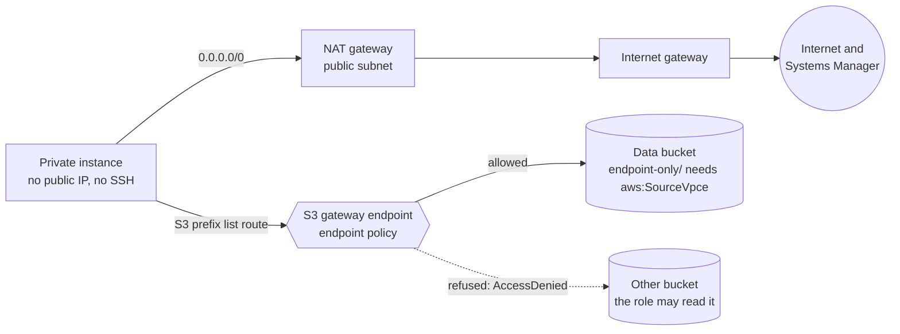

# Lab 03: NAT gateway vs S3 gateway endpoint

> **Deploy, observe and destroy the same day.** The NAT gateway bills by the hour and by the GB from the
> moment it exists until you run `terraform destroy`. The public IPv4 address it holds bills by the
> hour too. If CI applied the lab for you, destroy that stack the same day as well.

## What you build

Tasks 1.2 (secure workloads) and 4.4 (network costs) of the exam guide. Read the
[guide page for task 1.2](../../apps/site/src/content/docs/d1/1-2-secure-workloads/) first. This lab
builds the `vpc-nat-vs-gateway-endpoint` diagram in `us-east-1`, the Region of the diagram and its
prices, and lets you prove which path the traffic takes instead of only reading a route table.

- **A VPC** with DNS support and DNS hostnames on, and its default security group closed (no rule).
  Inside it sit a **public subnet** and a **private subnet**, both in the same Availability Zone. The
  lab asks AWS which zones offer the instance type and takes the first one, so it never lands in a zone
  without it.
- **An internet gateway** and a **public route table**: `0.0.0.0/0` goes to the internet gateway.
- **A NAT gateway** with an Elastic IP, in the public subnet. The **private route table** sends
  `0.0.0.0/0` to it, so the private subnet can start connections to the internet, and nothing on the
  internet can start one in.
- **An S3 gateway endpoint** in the private route table only. It adds a route whose destination is the
  S3 prefix list and whose target is the endpoint. That route is more specific than `0.0.0.0/0`, so
  S3 traffic of the private subnet takes it and never uses the NAT gateway. The endpoint is free.
- **An endpoint policy** that lets the data bucket through and nothing else. It never grants
  anything: it narrows what can pass through the endpoint, and only for traffic that uses the endpoint.
- **A private instance** (a `t4g.nano`, Amazon Linux 2023 on arm64) with no public IP, no key pair
  and no inbound rule. The only way in is Systems Manager (Session Manager and Run Command): its agent
  opens the connection itself, outbound over HTTPS, through the NAT gateway.
- **An instance role** (`fg-lab03-instance`) with the managed policy for the agent and an inline
  policy that allows **both** buckets. So the role never refuses the other bucket: only the endpoint
  policy does.
- **Two buckets**, private, with no ACLs and SSE-S3. The **data bucket** has a bucket policy with two
  denies and no allow: plain HTTP is refused, and `s3:GetObject` under `endpoint-only/` is refused
  unless the request carries the ID of the endpoint (`aws:SourceVpce`). The **other bucket** has no
  bucket policy.

The role carries `fg-workload-boundary`, the permissions boundary from `bootstrap/workload`, and
lives under the path `/lab/`. Neither that boundary nor the organization's service control policy
names an S3 action on these buckets, so every refusal in this lab comes from the endpoint policy or
the bucket policy, never from a guardrail around the lab.

Terraform puts no object in the buckets: the CI role that plans this stack may not read objects, so a
managed object would break the plan. You upload objects yourself (see [Observe](#observe)).



## Cost

Estimated with `infracost breakdown --path labs/03-nat-vs-gateway-endpoint`: **$36.56 per month**
(730 hours). That is the NAT gateway ($32.85), the instance ($3.07) and its 8 GB volume ($0.64).
Infracost does not price the public IPv4 address of the NAT gateway, so add it by hand: $0.005 an
hour, $3.65 a month. With it the lab costs **about $40.21 per month, $0.055 an hour or $1.32 a
day**. The data processed by the NAT gateway and the S3 requests depend on usage and are not in
those numbers.

| What                                            | Price                        |
| ----------------------------------------------- | ---------------------------- |
| NAT gateway, per hour it exists                 | $0.045                       |
| NAT gateway, per GB it processes                | $0.045                       |
| Public IPv4 address in use, per hour            | $0.005                       |
| `t4g.nano` instance, per hour                   | about $0.004 ($3.07 a month) |
| 8 GB gp3 volume                                 | $0.64 a month                |
| S3 gateway endpoint                             | free                         |
| S3 storage and requests for a few small objects | well under a cent            |

A lab that runs for an afternoon costs well under a dollar, and the NAT gateway is most of it. Left
on for a month it costs about $40, because a NAT gateway bills while it sits idle. The endpoint
costs nothing, so S3 traffic that takes the endpoint adds no NAT gateway charge per GB. The only
other things that bill by the hour are the instance and the public IPv4 address in the table.

## Prerequisites

- Terraform 1.14 or newer.
- A recent AWS CLI v2.
- The **Session Manager plugin** for the AWS CLI, which `aws ssm start-session` needs on your
  machine. See [Install the Session Manager plugin](https://docs.aws.amazon.com/systems-manager/latest/userguide/session-manager-working-with-install-plugin.html).
- An IAM Identity Center session with admin rights in your AWS account:
  `aws sso login --profile <profile>`, then set `AWS_PROFILE` to that profile.
- `bootstrap/workload` applied, following [its README](../../bootstrap/workload/README.md). It creates
  `fg-workload-boundary`, and IAM refuses to create a role whose boundary policy does not exist.
- bash 4 or newer to run `verify.sh` and the commands below. On Windows use Git Bash; typing `bash`
  in PowerShell may start WSL, which has none of your tools or your SSO session. On macOS the bash
  3.2 that ships with the system is too old, so run `brew install bash`.

The lab has no input variables. Example account IDs in this lab are AWS's documentation placeholder,
`111122223333`.

## Quick start in your own account

Run every command from `labs/03-nat-vs-gateway-endpoint/`.

1. Use a local backend. `backend_override.tf` is git-ignored:

   ```bash
   printf 'terraform {\n  backend "local" {}\n}\n' > backend_override.tf
   ```

   PowerShell (do not use `>` here: Windows PowerShell 5.1 would write UTF-16, which Terraform
   cannot read):

   ```powershell
   Set-Content backend_override.tf "terraform {`n  backend `"local`" {}`n}" -Encoding ascii
   ```

2. Initialise, plan, read the plan, then apply the saved plan. Write `-out lab.tfplan` with a space:
   PowerShell splits an `=` after `-out` at the dot of the file name. The `.tfplan` name is
   git-ignored.

   ```bash
   terraform init
   terraform plan -out lab.tfplan
   terraform apply lab.tfplan
   ```

   The plan has thirty-one resources: the network, the NAT gateway and its address, the endpoint, the
   instance with its role and security group, and the two buckets with their settings. The NAT
   gateway is billing from this moment.

3. Wait a few minutes for the agent on the instance to register, then check it with `bash verify.sh`
   (see [Verify](#verify)).

4. Try it by hand ([Observe](#observe)), then break it on purpose ([`break-it.md`](break-it.md)).
   Destroy the lab the same day ([Destroy now](#destroy-now)).

CI applies this lab too: `infra.yml` plans it on a pull request, applies it after merge once you
approve it in the `infra` environment, and then runs `verify.sh` with the read-only `fg-tf-plan`
role.

## Observe

Use one terminal for the steps that run on your machine, so the shell variables stay. The lab lives
in `us-east-1`.

1. Read the outputs and set the Region:

   ```bash
   export AWS_REGION=us-east-1
   PRIVATE_RT=$(terraform output -raw private_route_table_id)
   ENDPOINT=$(terraform output -raw s3_endpoint_id)
   NAT=$(terraform output -raw nat_gateway_id)
   NAT_IP=$(terraform output -raw nat_public_ip)
   INSTANCE=$(terraform output -raw instance_id)
   DATA=$(terraform output -raw data_bucket_name)
   OTHER=$(terraform output -raw other_bucket_name)
   echo "lab 03 probe" > probe.txt
   ```

2. Read the routes of the private subnet. There are three: the `local` route of the VPC, `0.0.0.0/0`
   to the NAT gateway, and a route whose destination is a prefix list (`pl-...`) and whose target is
   the endpoint:

   ```bash
   aws ec2 describe-route-tables --route-table-ids "$PRIVATE_RT" \
     --query 'Routes[].[DestinationCidrBlock,DestinationPrefixListId,GatewayId,NatGatewayId,State]' \
     --output table
   ```

   Both routes could match a request to S3. AWS picks the most specific one. The prefix list holds
   the address ranges of S3 in this Region, which are narrower than `0.0.0.0/0`, so S3 traffic takes
   the endpoint. Look at the list behind the route:

   ```bash
   read -r PREFIX_LIST ROUTE_STATE < <(aws ec2 describe-route-tables --route-table-ids "$PRIVATE_RT" \
     --query "Routes[?GatewayId=='$ENDPOINT'].[DestinationPrefixListId,State]" --output text | tr -d '\r')
   echo "$ROUTE_STATE"
   aws ec2 get-managed-prefix-list-entries --prefix-list-id "$PREFIX_LIST" \
     --query 'length(Entries)' --output text
   ```

   A route table only says where traffic **should** go. The next steps show where it goes.

3. Upload the probe file twice with your own identity: once under `endpoint-only/` in the data
   bucket, once to the other bucket. Your admin session may do this: the bucket policy denies reads
   only, and only under `endpoint-only/`:

   ```bash
   aws s3 cp probe.txt "s3://$DATA/endpoint-only/probe.txt"
   aws s3 cp probe.txt "s3://$OTHER/probe.txt"
   ```

4. Open a session on the instance. There is no SSH, no key pair and no open port: the security group
   has no inbound rule, and the agent on the instance called out to Systems Manager by itself, through
   the NAT gateway. First ask Systems Manager whether it sees the agent. It answers `Online`:

   ```bash
   PING=$(aws ssm describe-instance-information --filters "Key=InstanceIds,Values=$INSTANCE" \
     --query 'InstanceInformationList[0].PingStatus' --output text | tr -d '\r')
   echo "$PING"
   ```

   Then open the session. This needs the Session Manager plugin on your machine:

   ```bash
   aws ssm start-session --target "$INSTANCE"
   ```

   If the first command does not say `Online`, or the session says the target is not connected, the
   agent has not registered yet. Wait a minute and try again.

   Everything in steps 5 to 8 runs **on the instance**, in the session. Copy the two bucket names from
   your own terminal first (`echo "$DATA" "$OTHER"`).

5. Ask the internet which address you come from. The answer is the public IP of the NAT gateway (the
   `nat_public_ip` output, in your terminal as `$NAT_IP`): the instance has no address of its own, so
   the NAT gateway swaps in its own on the way out:

   ```bash
   curl -s --max-time 10 https://checkip.amazonaws.com
   ```

6. Set the names, then read the object under `endpoint-only/`. It works, and it can **only** work
   through the endpoint: the bucket policy refuses this read from anywhere else, because the request
   would not carry `aws:SourceVpce`. So S3 itself tells you the request came through the endpoint:

   ```bash
   export AWS_REGION=us-east-1
   DATA=<the data bucket name>
   OTHER=<the other bucket name>
   aws s3api get-object --bucket "$DATA" --key endpoint-only/probe.txt got.txt && cat got.txt
   ```

7. Read the object in the other bucket. It is `AccessDenied`, and the message names the VPC endpoint
   policy. The role's own policy allows this read (it lists both buckets), so nothing but the
   endpoint policy can have refused it:

   ```bash
   aws s3api get-object --bucket "$OTHER" --key probe.txt got.txt
   ```

   Always read with `aws s3api get-object` here, not with `aws s3 cp`. The `cp` command starts with a
   HEAD request, and an error answer to a HEAD request has no body, so all you get is
   `403 Forbidden` with no reason. `get-object` sends a GET, and the error body says why.

8. Send a 5 MB file to the data bucket. It goes through the endpoint, so the NAT gateway does not
   carry it. Then leave the session. You will look at the NAT gateway's bytes in step 10:

   ```bash
   head -c 5000000 /dev/zero > big.bin
   aws s3 cp big.bin "s3://$DATA/big.bin"
   exit
   ```

9. Back on your machine, try the opposite. You are outside the VPC and your identity is not the
   instance's. The object under `endpoint-only/` is refused (`AccessDenied`, "with an explicit deny in
   a resource-based policy": the bucket policy). The object in the other bucket can be read, because
   nothing refuses it from here, which also shows the object exists:

   ```bash
   aws s3api get-object --bucket "$DATA" --key endpoint-only/probe.txt /dev/null
   aws s3api get-object --bucket "$OTHER" --key probe.txt /dev/null --query ContentLength --output text
   ```

10. Read the evidence of the cost. `BytesOutToDestination` is what the NAT gateway sent out, in
    bytes per minute. It stays low: the agent's traffic goes through the NAT gateway, and your 5 MB
    upload did not. Give CloudWatch a couple of minutes first:

    ```bash
    aws cloudwatch get-metric-statistics --namespace AWS/NATGateway --metric-name BytesOutToDestination \
      --dimensions "Name=NatGatewayId,Value=$NAT" --period 60 --statistics Sum \
      --start-time "$(date -u -d '20 minutes ago' +%Y-%m-%dT%H:%M:%SZ)" \
      --end-time "$(date -u +%Y-%m-%dT%H:%M:%SZ)" \
      --query 'sort_by(Datapoints,&Timestamp)[].[Timestamp,Sum]' --output text
    ```

    [`break-it.md`](break-it.md) removes the endpoint route and repeats the upload: then the same
    bytes go through the NAT gateway, and the number rises.

Delete `probe.txt` from the lab directory when you are done.

## Verify

`bash verify.sh` checks an applied stack, yours or the one CI applied. Run it from the stack
directory, after `terraform init` or a local apply, in Git Bash on Windows. It reads everything from
the `terraform output` values. It prints `ok`, `FAIL` or `skip` per check, and no account ID, ARN,
bucket name, resource ID or IP address, so the output is safe in a public log. It checks, read-only:

- **the network:** DNS on, the public route to an internet gateway, the private routes (to the NAT
  gateway, and the S3 prefix list to the endpoint, with no route to an internet gateway), the NAT
  gateway and the endpoint;
- **the endpoint policy:** it names the data bucket, not the other one, and allows no resource `*`;
- **the instance:** running, no public IP, no key pair, IMDSv2 required, no inbound rule;
- **its role:** path `/lab/`, the `fg-workload-boundary` permissions boundary, the managed policy
  for Systems Manager, and (IAM policy simulator) the actions of the agent and a read of the other
  bucket allowed by IAM;
- **the buckets:** Block Public Access, and the bucket policy of the data bucket, with no `Null` and
  no `IfExists` condition on the deny;
- **Systems Manager:** the instance is `Online`. `verify.sh` asks up to sixty times, five seconds
  apart (`VERIFY_POLL_SECONDS` changes the wait), because the agent registers a little after the
  instance starts.

The simulator cannot read a bucket policy or an endpoint policy, so their denies can only be tested
for real. With `VERIFY_ASSUME=1 bash verify.sh` the script also runs the live checks: Run Command and
a Session Manager session on the instance (the Session Manager plugin must be installed), the
internet address the instance shows (the NAT gateway's), a read through the endpoint, an upload
through the endpoint, the other bucket refused by the endpoint policy, and, from your machine, the
read under `endpoint-only/` refused by the bucket policy and the read of the other bucket accepted.
It uploads two small probe objects (`verify-probe.txt`) with your identity. The live checks need
`ssm:SendCommand`, `ssm:StartSession` and `s3:PutObject`, which the read-only CI role does not have,
so CI runs without them. The script never deletes an object and never changes a route or the
endpoint: the probes stay until the next run overwrites them or `terraform destroy` empties the
buckets. Removing the routes is for you to do by hand ([`break-it.md`](break-it.md)).

Expect `verify: ok (17 passed, 9 skipped)`, or `verify: ok (26 passed, 0 skipped)` with
`VERIFY_ASSUME=1`.

Exit codes: `0` every check passed, `1` a check failed, `2` the script could not run (an argument, a
missing tool, an empty `terraform output` or no AWS session).

## Destroy now

The NAT gateway and the public IPv4 address stop billing only when they are destroyed, so clean up
the same day.

- **Local stack:** `terraform destroy` from the lab directory. Terraform removes the instance, then
  the NAT gateway, its address and the internet gateway, in that order. `force_destroy` empties both
  buckets, so your probe objects do not block it. If the destroy stops part way, run it again.
  Check that the NAT gateway is gone: its state shows `deleted` (for a while it is still listed),
  and `available` means it still bills:

  ```bash
  aws ec2 describe-nat-gateways --filter "Name=tag:project,Values=saa-c03-field-guide" \
    --query 'NatGateways[].[NatGatewayId,State]' --output text
  ```

  Then delete `backend_override.tf`, `terraform.tfstate*`, `lab.tfplan`, `probe.txt` and
  `heartbeat.txt`. Destroy `bootstrap/workload` only if nothing else in the account uses it.

- **CI stack:** dispatch `infra.yml` from `main` with the action `destroy`, the stack
  `labs/03-nat-vs-gateway-endpoint` and the confirmation `destroy labs/03-nat-vs-gateway-endpoint`.
  You approve it in the `infra` environment.
