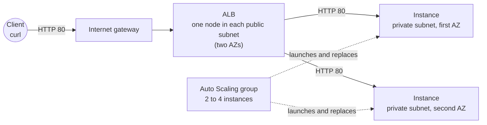

# Lab 04: ALB + Auto Scaling self-healing across AZs

> **Deploy, observe and destroy the same day.** The Application Load Balancer and the two instances
> bill by the hour from the moment they exist until you run `terraform destroy`, and the load
> balancer's two public IPv4 addresses bill by the hour too. If CI applied the lab for you, destroy
> that stack the same day as well.

## What you build

Task 2.2 (high availability) of the exam guide. Read the
[guide page for task 2.2](../../apps/site/src/content/docs/d2/2-2-high-availability/) first. This lab
builds the `alb-asg-az-failure` diagram in `eu-west-1`, the Region of the diagram and of the Terraform
state, and lets you watch a load balancer spread requests over two Availability Zones (AZs), an Auto
Scaling group replace an instance, and a zonal shift move traffic away from one AZ.

- **A VPC** with DNS support and DNS hostnames on, and its default security group closed (no rule).
  Inside it sit two **public subnets** and two **private subnets**, one of each in each of two AZs. The
  lab asks AWS which zones offer the instance type and takes the first two in alphabetical order.
- **An internet gateway** and a **public route table**: `0.0.0.0/0` goes to the internet gateway. The
  **private route table** has no route of its own, only the `local` route of the VPC.
- **An Application Load Balancer** (ALB), internet-facing, with one node in each public subnet. It has
  one HTTP listener on port 80 that forwards to a target group. Its security group allows TCP 80 in
  from anywhere and TCP 80 out to the instances' security group only.
- **A target group** of instance targets with a health check on `/`, tuned to react faster than the
  defaults (see the table below).
- **A launch template and an Auto Scaling group** of two `t4g.nano` instances (Amazon Linux 2023 on
  arm64), minimum 2, maximum 4, in the two private subnets. The group registers its instances in the
  target group and uses the load balancer's health check (`health_check_type = "ELB"`). The maximum of
  4 only gives the group room to rebalance: the lab has no scaling policy.
- **A user data script** that starts a small web server with the `python3` that ships with the
  standard AMI. Each instance answers with its own instance ID and AZ, for example
  `instance=i-0123456789abcdef0 az=eu-west-1a`, so a `curl` loop shows who answered.
- **Instances that can only be reached through the load balancer.** They have no public IP, no key
  pair and no instance role, IMDSv2 is required, and the root volume is an encrypted 8 GB gp3 volume.
  The instances' security group allows TCP 80 in from the load balancer's group, and nothing else.
- **Zonal shift** is switched on for the load balancer. A zonal shift moves traffic away from one AZ.

The launch template tags the instances, their volumes and their network interfaces with the lab tags,
because default tags are not copied to what an Auto Scaling group launches.



### No NAT gateway, no role, no egress rule

Most private instances need a NAT gateway to reach the internet, and a role to call AWS. These
instances call nothing. The web server is `python3`, which is already on the AMI, so the user data
installs no package. It reads the instance ID and the AZ from the instance metadata service, which is
a link-local address that needs no route and no rule.
So the lab has:

- **no NAT gateway** (about $1 a day at the usual price, and none of it is needed here), no endpoint
  and no route out of the private subnets;
- **no instance role**, so nothing in this lab needs `iam:PassRole` or the permissions boundary;
- **no egress rule** on the instances' security group. Terraform removes the allow-all outbound rule
  that AWS adds to a new group, and nothing replaces it. Security groups are stateful: the reply to a
  request or a health check that was allowed in leaves on the same connection, whatever the outbound
  rules say. The instances can answer the load balancer and can start nothing themselves.

The price is that you cannot log in either. There is no SSH, and Systems Manager would need a NAT
gateway or interface endpoints. The lab is read and broken from the outside, with the AWS CLI.

### Health check values

The lab sets every health check value on purpose. Terraform's own defaults (a timeout of 6 seconds and
thresholds of 3 for an HTTP target group) differ from AWS's, so leaving them out would hide what the
setup does.

| Setting                          | AWS default (ALB, instance targets)               | This lab    |
| -------------------------------- | ------------------------------------------------- | ----------- |
| Health check interval            | 30 seconds                                        | 10 seconds  |
| Health check timeout             | 5 seconds                                         | 5 seconds   |
| Healthy threshold                | 5                                                 | 2           |
| Unhealthy threshold              | 2                                                 | 2           |
| Success code                     | 200                                               | 200         |
| Path                             | `/`                                               | `/`         |
| Deregistration delay             | 300 seconds                                       | 30 seconds  |
| Auto Scaling health check grace  | 300 seconds in the console, 0 with the CLI or SDK | 120 seconds |
| Auto Scaling health check source | EC2 status checks only                            | ELB         |

### Zonal shift on the group

The load balancer has zonal shift enabled, and [`break-it.md`](break-it.md) starts a shift on it. An Auto
Scaling group can be opted in to zonal shift too, with an `AvailabilityZoneImpairmentPolicy`
(`ZonalShiftEnabled`, and `IgnoreUnhealthy` or `ReplaceUnhealthy`). A group that is opted in launches new
capacity only in the AZs that are not shifted. This lab does not do it: the Terraform AWS provider has no
argument for it yet, so it would take a console or CLI step outside Terraform. The break-it experiment
shows what the load balancer does on its own.

## Cost

Estimated with `infracost breakdown --path labs/04-alb-asg-self-healing`: **$26.52 per month**
(730 hours). That is the load balancer's hours ($18.40), two `t4g.nano` instances ($6.72) and their two
8 GB gp3 volumes ($1.41). Infracost does not price the load balancer's two public IPv4 addresses (one
per AZ), so add them by hand: 2 × $0.005 × 730 hours is **$7.30** a month. With them the lab costs
**about $33.8 a month, or about $0.046 an hour**. The load balancer capacity units (LCUs) depend on
traffic and are not in those numbers.

| What                                      | Price                                      |
| ----------------------------------------- | ------------------------------------------ |
| Application Load Balancer, per hour       | $0.0252 (a partial hour is billed as full) |
| Load balancer capacity unit, per LCU-hour | $0.008                                     |
| Public IPv4 address in use, per hour      | $0.005 each, two addresses on the ALB      |
| `t4g.nano` instance, per hour             | $0.0046 each, two instances                |
| gp3 volume, per GB-month                  | $0.088 (two 8 GB volumes)                  |
| Zonal shift                               | no additional charge                       |
| NAT gateway                               | none: the lab does not create one          |

An afternoon of 4 hours costs about $0.19. A forgotten day costs about $1.11, and a forgotten month
about $34. The price of the ALB hour is per hour or part of an hour, so a short experiment still pays
for whole hours. Everything here bills while it sits idle, so destroy the lab when you are done.

## Prerequisites

- Terraform 1.14 or newer.
- A recent AWS CLI v2.
- An IAM Identity Center session with admin rights in your AWS account:
  `aws sso login --profile <profile>`, then set `AWS_PROFILE` to that profile.
- `bootstrap/workload` applied, following [its README](../../bootstrap/workload/README.md). This lab
  creates no role of its own, but that stack sets up the guardrails of the account.
- bash 4 or newer to run `verify.sh` and the commands below, and `curl`. On Windows use Git Bash;
  typing `bash` in PowerShell may start WSL, which has none of your tools or your SSO session. On macOS
  the bash 3.2 that ships with the system is too old, so run `brew install bash`.

The lab has no input variables. Example account IDs in this lab are AWS's documentation placeholder,
`111122223333`.

## Quick start in your own account

Run every command from `labs/04-alb-asg-self-healing/`.

1. Use a local backend. `backend_override.tf` is git-ignored:

   ```bash
   printf 'terraform {\n  backend "local" {}\n}\n' > backend_override.tf
   ```

   PowerShell (do not use `>` here: Windows PowerShell 5.1 would write UTF-16, which Terraform
   cannot read):

   ```powershell
   Set-Content backend_override.tf "terraform {`n  backend `"local`" {}`n}" -Encoding ascii
   ```

2. Initialise, plan, read the plan, then apply the saved plan. Write `-out lab.tfplan` with a space:
   PowerShell splits an `=` after `-out` at the dot of the file name. The `.tfplan` name is
   git-ignored.

   ```bash
   terraform init
   terraform plan -out lab.tfplan
   terraform apply lab.tfplan
   ```

   The plan ends with `Plan: 24 to add`: the network, the two security groups and their rules, the
   load balancer with its target group and listener, and the launch template and the group. The load
   balancer is billing from this moment. The first time an AWS account creates a load balancer or an
   Auto Scaling group, AWS creates a service-linked role for the service (it is free and stays after
   the destroy). If the apply fails on one of them right after it was created, the resources that did get
   created change the picture, so `terraform apply lab.tfplan` then stops with `Saved plan is stale`.
   Run `terraform plan -out lab.tfplan` again, then `terraform apply lab.tfplan`. In CI, dispatch the
   apply again: the apply job checks that the plan is the one you approved and refuses a changed one.

3. Wait a few minutes for the instances to start and pass the health check, then check the stack with
   `bash verify.sh` (see [Verify](#verify)).

4. Try it by hand ([Observe](#observe)), then break it on purpose ([`break-it.md`](break-it.md)).
   Destroy the lab the same day ([Destroy now](#destroy-now)).

CI applies this lab too: `infra.yml` plans it on a pull request, applies it after merge once you
approve it in the `infra` environment, and then runs `verify.sh` with the read-only `fg-tf-plan`
role.

## Observe

Use one terminal for these steps, so the shell variables stay. [`break-it.md`](break-it.md) uses the
same variables.

1. Read the outputs and set the Region. `tr -d '\r'` removes the carriage return that Windows tools
   add to a line:

   ```bash
   export AWS_REGION=eu-west-1
   DNS=$(terraform output -raw alb_dns_name | tr -d '\r')
   ALB=$(terraform output -raw alb_arn | tr -d '\r')
   TG=$(terraform output -raw target_group_arn | tr -d '\r')
   ASG=$(terraform output -raw asg_name | tr -d '\r')
   PRIVATE_RT=$(terraform output -raw private_route_table_id | tr -d '\r')
   read -r AZ1 AZ2 < <(terraform output -raw availability_zones | tr -d '\r')
   ```

2. Send ten requests to the load balancer. Both AZs answer, in no fixed order: DNS returns the
   addresses of the load balancer's two nodes, and with cross-zone load balancing a node spreads its
   requests over the targets of every AZ. Right after the apply the requests can fail until the
   targets are healthy, so repeat the loop after a minute or two:

   ```bash
   for i in $(seq 10); do curl -s "http://$DNS/"; done
   ```

3. Ask the target group what it sees. Both targets are `healthy`. Right after the apply they are
   `initial` while the load balancer runs its first health checks:

   ```bash
   aws elbv2 describe-target-health --target-group-arn "$TG" \
     --query 'TargetHealthDescriptions[].[Target.Id,TargetHealth.State]' --output table
   ```

4. Ask the Auto Scaling group which instances it runs, in which AZ, and what it thinks of them. Two
   instances, one in each AZ, `InService` and `Healthy`:

   ```bash
   aws autoscaling describe-auto-scaling-groups --auto-scaling-group-names "$ASG" \
     --query 'AutoScalingGroups[0].Instances[].[InstanceId,AvailabilityZone,LifecycleState,HealthStatus]' \
     --output table
   ```

5. Try to reach an instance without the load balancer. You cannot, for two reasons: it has no public
   IP, and its subnet has no route out. The private route table holds one route, the `local` route of
   the VPC:

   ```bash
   aws ec2 describe-route-tables --route-table-ids "$PRIVATE_RT" \
     --query 'RouteTables[0].Routes[].[DestinationCidrBlock,GatewayId]' --output text
   ```

   Its security group would also refuse you: the only inbound rule accepts TCP 80 from the load
   balancer's group.

## Verify

`bash verify.sh` checks an applied stack, yours or the one CI applied. Run it from the stack
directory, after `terraform init` or a local apply, in Git Bash on Windows. It reads everything from
the `terraform output` values. It prints `ok` or `FAIL` per check, and no account ID, ARN, DNS name,
resource ID or IP address, so the output is safe in a public log. It makes 15 checks, and only reads:

- **the load balancer:** active, internet-facing, an Application Load Balancer, IPv4, in the two AZs,
  zonal shift enabled, and one HTTP listener on port 80 that forwards to the target group;
- **the target group:** the health check values and the deregistration delay of the table above;
- **the group:** the size, the ELB health check type and the grace period, the target group, and the
  two private subnets;
- **the instances:** at least two, with no public IP, no key pair and no role, IMDSv2 required, and the
  project tag;
- **the network:** the instances' security group has one inbound rule (from the load balancer's group)
  and no egress rule, the private route table holds only the `local` route, and the VPC has no NAT
  gateway;
- **live:** up to sixty polls, five seconds apart (`VERIFY_POLL_SECONDS` changes the wait), until two
  targets are `healthy` (`describe-target-health`); then up to thirty plain HTTP requests to the load
  balancer, until both AZs have answered and every answer came from a lab instance.

The script never terminates an instance, changes a health check or starts a zonal shift: the breaks
are for you to do by hand ([`break-it.md`](break-it.md)).

Expect `verify: ok (15 passed, 0 skipped)`.

Exit codes: `0` every check passed, `1` a check failed, `2` the script could not run (an argument, a
missing tool, an empty `terraform output` or no AWS session).

## Destroy now

The load balancer and the instances stop billing only when they are destroyed, so clean up the same
day.

- **Local stack:** `terraform destroy` from the lab directory. Terraform removes the group and its
  instances first, then the listener and the load balancer, then the route and the internet gateway.
  If the destroy stops part way, run it again. Check that the load balancer is gone. The Region is in
  the command because a new terminal has lost it, and `LoadBalancerNotFound` is the answer you want:

  ```bash
  aws elbv2 describe-load-balancers --region eu-west-1 --names fg-lab04-web
  ```

  Then delete `backend_override.tf`, `terraform.tfstate*` and `lab.tfplan`. Destroy
  `bootstrap/workload` only if nothing else in the account uses it.

- **CI stack:** dispatch `infra.yml` from `main` with the action `destroy`, the stack
  `labs/04-alb-asg-self-healing` and the confirmation `destroy labs/04-alb-asg-self-healing`. You
  approve it in the `infra` environment.

After a CI destroy, any later change under this lab's folder (other than to Markdown files) selects the
stack again, and `infra.yml` then offers to create all 24 resources at the approval gate. Reject that
request unless you plan a live day.
