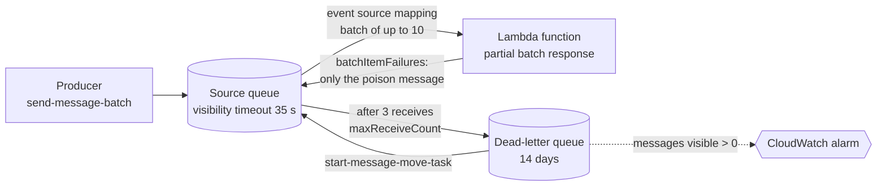

# Lab 05: SQS + Lambda + dead-letter queue

> **Nothing here bills by the hour, but every request does.** The event source mapping keeps polling
> the queue even when it is empty, and each poll is an SQS request. Destroy the lab when you are done
> (see [Destroy now](#destroy-now)), and do the same for a stack that CI applied for you.

## What you build

Task 2.1 of the exam guide (scalable and loosely coupled architectures). Read the
[guide page for task 2.1](../../apps/site/src/content/docs/d2/2-1-scalable-loosely-coupled/) first.
This lab builds the `sqs-lambda-dlq` diagram ([`diagrams/sqs-lambda-dlq.yaml`](../../diagrams/sqs-lambda-dlq.yaml))
in `eu-west-1`, the Region of the diagram, and lets you watch a poison message fail, land in a
dead-letter queue (DLQ) and come back, instead of only reading about it.

- **A source queue** (`fg-lab05-orders`): a standard queue with SSE-SQS (keys owned by SQS, so no KMS
  key and no KMS charge). Messages stay 4 days. The **visibility timeout is 35 seconds**, which is
  6 × 5 + 5: six times the 5-second function timeout, plus the 5-second batching window. That is the
  rule of the Lambda documentation. If the queue hides a message for less time than the function needs,
  the message becomes visible again while it is still being processed and is processed twice.
- **A dead-letter queue** (`fg-lab05-orders-dlq`), also SSE-SQS. Its retention is **14 days**, longer
  than the source queue's 4. For a standard queue a message expires by its original enqueue time, also
  after it moved to the DLQ, so a DLQ with the same retention could lose a message before anyone looked
  at it. A **redrive allow policy** on the DLQ names the source queue as the only queue that may use it.
- **A redrive policy** on the source queue: a message that was received 3 times and not deleted moves
  to the DLQ (`maxReceiveCount` = 3). 3 is the number in the diagram and it makes the demo fast. The
  Lambda documentation recommends **at least 5**, because Lambda can receive a message more than once
  without the function failing it (a throttled invocation, for example), and every such receive counts.
- **A Python function** (`fg-lab05-orders-consumer`, `python3.14`, arm64, 128 MB, 5 seconds) and an
  **event source mapping** on the source queue: batches of up to 10 messages, a 5-second batching
  window, and `ReportBatchItemFailures`. A good order is a JSON object with a non-empty string
  `order_id`; anything else is a poison message. The function never fails as a whole: it answers with
  the IDs of the messages it could not process, so Lambda deletes the rest of the batch and returns
  only those to the queue. There is no maximum concurrency setting on the mapping: with it, Lambda
  cannot scale its pollers down on a quiet queue.
- **A log group** (`/aws/lambda/fg-lab05-orders-consumer`) that keeps one day of logs.
- **A role** (`fg-lab05-consumer`) with an inline policy of two statements: receive, delete and read
  the attributes of the source queue, and create log streams and put log events in the log group.
  Nothing on the DLQ: SQS itself moves the messages there.
- **An alarm** (`fg-lab05-orders-dlq-not-empty`) that goes to `ALARM` when the DLQ has a message
  visible. It has no action: there is no SNS topic, so you look at it yourself.

The role carries `fg-workload-boundary`, the permissions boundary from `bootstrap/workload`, and lives
under the path `/lab/`. The boundary denies every role write, `iam:PassRole` and `sts:AssumeRole`
outside `role/lab/*`, and refuses to create a role without itself. The role that applies this stack
has the same denies, so a role outside `/lab/` or without the boundary makes the apply fail.

The role has **no `logs:CreateLogGroup`**, and it does not use the managed policy
`AWSLambdaSQSQueueExecutionRole` (which has it, and the SQS actions on every queue). Terraform
creates the log group with its one-day retention before the function exists. If the role could create
log groups, an invocation after a destroy (a poller that is still running) could create the group
again, with no retention and no tags.



## Cost

Estimated with `infracost breakdown --path labs/05-sqs-lambda-dlq`: **$0.10 per month**, all of it the
alarm (and the first ten alarms of an AWS Organization are free). Everything else is billed by use,
so infracost shows prices and no total for it. With an uncommitted usage file for one live day
(about 50 Lambda requests of 1 second at 128 MB, about 25,000 SQS requests of idle polling and 1 MB of
logs) infracost gives **$0.11**: $0.10 for the alarm, which is a month's price for something that exists
for one day, and $0.01 for the SQS requests. Infracost does not apply any free tier.

| What                                | List price in `eu-west-1`                                         |
| ----------------------------------- | ----------------------------------------------------------------- |
| Lambda requests                     | $0.20 per million (the first million a month is free)             |
| Lambda duration, arm64              | $0.0000133334 per GB-second (400,000 GB-seconds a month are free) |
| SQS requests, standard queue        | $0.40 per million (the first million a month is free)             |
| CloudWatch Logs ingestion           | $0.57 per GB (the first 5 GB a month are free)                    |
| CloudWatch Logs storage             | $0.03 per GB-month (one day of retention keeps it near zero)      |
| Standard alarm                      | $0.10 per alarm-month (the first 10 are free)                     |
| KMS, NAT gateway, load balancer, DB | none in this lab                                                  |

An SQS request is up to 10 messages, and each 64 KB chunk of a payload counts as one request. A full
run of the lab (send, watch, break, destroy) takes an hour or two and costs well under one cent at
list prices. The free tiers are per AWS Organization, so every account of the Organization shares
them.

**The idle pollers are the part to watch.** Lambda long-polls the queue for the mapping and the
polls of an empty queue are SQS requests, billed like any other (long and short polling cost the same).
How many Lambda makes is not documented: the documentation says it can scale down to as few as 2
concurrent pollers on a quiet queue. The 25,000 requests a day in the usage file above are an
assumption, not a measurement. Read the real rate on the live day: the CloudWatch metric
`NumberOfEmptyReceives` of the source queue (namespace `AWS/SQS`, dimension `QueueName`) counts the
polls that found nothing. This section gets the measured figure when it is known. Until then, do not
leave the lab running.

## Prerequisites

- Terraform 1.14 or newer.
- A recent AWS CLI v2.
- An IAM Identity Center session with admin rights in your AWS account:
  `aws sso login --profile <profile>`, then set `AWS_PROFILE` to that profile.
- `bootstrap/workload` applied, following [its README](../../bootstrap/workload/README.md). It creates
  `fg-workload-boundary`, and IAM refuses to create a role whose boundary policy does not exist.
- bash 4 or newer to run `verify.sh` and the commands below. On Windows use Git Bash; typing `bash`
  in PowerShell may start WSL, which has none of your tools or your SSO session. On macOS the bash
  3.2 that ships with the system is too old, so run `brew install bash`.

The lab has three input variables, all with defaults: `function_timeout_seconds` (5),
`batching_window_seconds` (5) and `visibility_timeout_seconds` (35). Terraform refuses a visibility
timeout below six times the function timeout plus the batching window. Example account IDs in this
lab are AWS's documentation placeholder, `111122223333`.

## Quick start in your own account

Run every command from `labs/05-sqs-lambda-dlq/`.

1. Use a local backend. `backend_override.tf` is git-ignored:

   ```bash
   printf 'terraform {\n  backend "local" {}\n}\n' > backend_override.tf
   ```

   PowerShell (do not use `>` here: Windows PowerShell 5.1 would write UTF-16, which Terraform
   cannot read):

   ```powershell
   Set-Content backend_override.tf "terraform {`n  backend `"local`" {}`n}" -Encoding ascii
   ```

2. Initialise, plan, read the plan, then apply the saved plan. Write `-out lab.tfplan` with a space:
   PowerShell splits an `=` after `-out` at the dot of the file name. The `.tfplan` name is
   git-ignored.

   ```bash
   terraform init
   terraform plan -out lab.tfplan
   terraform apply lab.tfplan
   ```

   The plan has ten resources: the two queues and their two policies, the role and its policy, the log
   group, the function, the event source mapping and the alarm. Terraform builds `.build/handler.zip`
   from `src/handler.py` on your machine. The event source mapping polls the queue from the moment it
   exists.

3. Check it with `bash verify.sh` (see [Verify](#verify)).

4. Try it by hand ([Observe](#observe)), then break it on purpose ([`break-it.md`](break-it.md)).
   Destroy the lab when you are done ([Destroy now](#destroy-now)).

CI applies this lab too: `infra.yml` plans it on a pull request, applies it after merge once you
approve it in the `infra` environment, and then runs `verify.sh` with the read-only `fg-tf-plan`
role.

## Observe

Use one terminal, so the shell variables stay. The lab lives in `eu-west-1`.

1. Read the outputs and set the Region:

   ```bash
   export AWS_REGION=eu-west-1
   SOURCE_URL=$(terraform output -raw source_queue_url | tr -d '\r')
   DLQ_URL=$(terraform output -raw dlq_url | tr -d '\r')
   DLQ_ARN=$(terraform output -raw dlq_arn | tr -d '\r')
   MAPPING=$(terraform output -raw event_source_mapping_uuid | tr -d '\r')
   LOG_GROUP=$(terraform output -raw log_group_name | tr -d '\r')
   ALARM=$(terraform output -raw alarm_name | tr -d '\r')
   ```

2. Send a good order and a poison message in one batch. The good order is a JSON object with an
   `order_id`; `not an order` is not JSON at all:

   ```bash
   aws sqs send-message-batch --queue-url "$SOURCE_URL" \
     --entries '[{"Id":"good","MessageBody":"{\"order_id\":\"o-1\"}"},{"Id":"poison","MessageBody":"not an order"}]'
   ```

   The function usually receives both in one batch, but that is not guaranteed: Lambda may hand them
   over in two invocations a few seconds apart. The result is the same either way.

3. Follow the log of the function. Press Ctrl+C when you have seen enough. `processed order o-1`
   appears **once**: the function reports only the poison message as failed, so Lambda deletes the
   good order. `failed message <id>` appears **three times**, 35 to 40 seconds apart: each time the
   message is hidden for the visibility timeout, then becomes visible again and is received again
   (the batching window adds a few seconds). Logs can arrive a few seconds late:

   ```bash
   MSYS_NO_PATHCONV=1 aws logs tail "$LOG_GROUP" --follow
   ```

   The path starts with a slash. Git Bash would rewrite it into a Windows path, so `MSYS_NO_PATHCONV=1`
   is in front of every `aws logs` command of this lab.

4. After about 3 × 35 seconds, SQS moves the poison message to the DLQ. It is one message there:

   ```bash
   aws sqs get-queue-attributes --queue-url "$DLQ_URL" --attribute-names ApproximateNumberOfMessages \
     --query Attributes.ApproximateNumberOfMessages --output text
   ```

   The source queue is empty again (the counts are approximate and can take a moment to settle).

5. The alarm looks at the DLQ's `ApproximateNumberOfMessagesVisible` once a minute, so it needs a
   minute or two to go from `OK` to `ALARM`:

   ```bash
   aws cloudwatch describe-alarms --alarm-names "$ALARM" --query 'MetricAlarms[0].StateValue' --output text
   ```

6. In the console, the SQS page of the DLQ has a **Start DLQ redrive** button. It calls the same API as
   `aws sqs start-message-move-task`, which [`break-it.md`](break-it.md) uses to send the message back
   to the source queue.

This page never reads messages from a queue: reading hides them from the function and adds to their
receive count. You see them in the logs and in the queue counts.

## Verify

`bash verify.sh` checks an applied stack, yours or the one CI applied. Run it from the stack
directory, after `terraform init` or a local apply, in Git Bash on Windows. It reads everything from
the `terraform output` values. It prints `ok`, `FAIL` or `skip` per check, and no account ID, ARN,
queue URL, mapping UUID or message ID, so the output is safe in a public log. It checks, read-only:

- **the queues:** the visibility timeout, the retention and SSE-SQS of the source queue, its redrive
  policy (the DLQ and a `maxReceiveCount` of 3), and the retention, SSE-SQS and redrive allow policy of
  the DLQ;
- **the function:** runtime, architecture, timeout, memory, state and role;
- **its role:** path `/lab/`, the `fg-workload-boundary` permissions boundary, and (IAM policy
  simulator) the three queue actions allowed and `logs:CreateLogGroup` not allowed;
- **the mapping, the log group and the alarm:** an enabled mapping with batch size 10, window 5 and
  partial batch responses; one day of log retention; an alarm on the DLQ with no action.

With `VERIFY_SEND=1 bash verify.sh` the script also runs four live checks. It sends a good order and a
poison message, waits for the good order in the logs, for the poison message in the DLQ, checks that
the good order was processed once, and waits for the alarm to go to `ALARM`. It leaves one message in
the DLQ, because [`break-it.md`](break-it.md) redrives it. The live checks are opt-in because they send
messages (`sqs:SendMessage`), which the read-only CI role cannot do, so CI runs without them. When
the DLQ already held a message before the run (for example from an earlier `VERIFY_SEND=1` run),
`alarm-fires` may pass because the alarm was already in `ALARM`: a fresh alarm transition is seen
only from an empty DLQ. The
script never reads or deletes a message, never starts a redrive and never changes a queue or the
mapping. The waits are up to a few minutes: `VERIFY_POLL_SECONDS` (default 5) changes the time between
two polls.

Expect `verify: ok (11 passed, 4 skipped)`, or `verify: ok (15 passed, 0 skipped)` with
`VERIFY_SEND=1`.

Exit codes: `0` every check passed, `1` a check failed, `2` the script could not run (an argument, a
missing tool, an empty `terraform output` or no AWS session).

## Destroy now

Nothing bills by the hour, but the poller bills by the request for as long as the mapping exists, so
clean up when you are done.

- **Local stack:** `terraform destroy` from the lab directory. Messages left in the queues go with
  them. If the destroy stops part way, run it again. Then delete `backend_override.tf`,
  `terraform.tfstate*`, `lab.tfplan` and the `.build/` folder. Destroy `bootstrap/workload` only if
  nothing else in the account uses it.

- **CI stack:** dispatch `infra.yml` from `main` with the action `destroy`, the stack
  `labs/05-sqs-lambda-dlq` and the confirmation `destroy labs/05-sqs-lambda-dlq`. You approve it in
  the `infra` environment.
